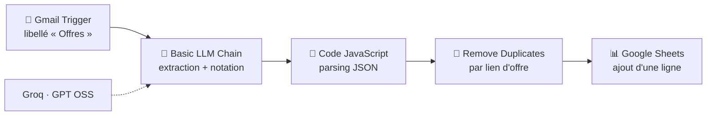

# 🤖 Agent IA de veille et de tri d'offres d'emploi

Un workflow **n8n** qui collecte automatiquement les offres d'emploi reçues par email (LinkedIn, Welcome to the Jungle, APEC, Indeed…), utilise un **LLM** pour extraire chaque offre et évaluer sa compatibilité avec mon profil, puis centralise le tout dans **Google Sheets**, trié par score.


---

## 🎯 Le problème

En recherche d'emploi, les alertes arrivent de plusieurs plateformes, chacune avec son propre format d'email. Les trier à la main prend du temps, et les offres pertinentes se perdent au milieu de postes seniors, de stages ou de missions hors sujet.

**Objectif :** ne plus lire les alertes une par une, mais ouvrir un seul tableau où chaque offre est déjà extraite, classée par piste (Data/IA ou CRM) et notée selon sa pertinence pour mon profil.

---

## ⚙️ Fonctionnement



1. **Gmail Trigger** : vérifie toutes les heures les nouveaux emails portant le libellé `Offres`. Des filtres Gmail rangent automatiquement les alertes de chaque plateforme dans ce libellé.
2. **Basic LLM Chain (Groq)** : le modèle lit l'email, quel que soit son format, et renvoie un JSON contenant chaque offre avec :
   - source, titre, entreprise, lieu, type de contrat, lien ;
   - **piste** : `Data/IA` ou `CRM` ;
   - **score** de compatibilité de 0 à 100 ;
   - **justification** du score en une phrase.
3. **Code JavaScript** : nettoie et analyse la réponse du modèle, puis transforme chaque offre en un élément séparé.
4. **Remove Duplicates** : ignore les offres déjà traitées lors des exécutions précédentes (dédoublonnage sur le lien), pour éviter les doublons quand une offre apparaît dans plusieurs alertes.
5. **Google Sheets** : ajoute une ligne par nouvelle offre, avec le statut initial `À postuler`.


---

## 🛠️ Stack technique

| Composant | Outil |
|---|---|
| Orchestration | n8n (auto-hébergé) |
| LLM | Groq API – `openai/gpt-oss-20b` |
| Source des données | Gmail API (alertes emploi) |
| Stockage | Google Sheets API |
| Traitement | JavaScript (nœud Code n8n) |

---

## 🧠 Choix techniques et difficultés rencontrées

**Un LLM plutôt qu'un parseur par plateforme**
Chaque site formate ses emails différemment, et ces formats changent sans prévenir. Écrire un parseur par plateforme aurait été fragile. Le LLM lit n'importe quel format, et la même étape sert à la fois à extraire et à noter les offres.

**Pas de scraping**
LinkedIn et Indeed interdisent le scraping dans leurs conditions d'utilisation. Passer par les alertes email officielles rend la solution légale, stable et sans risque pour mes comptes.

**Changement de fournisseur de LLM**
Le projet a d'abord utilisé l'API Mistral, mais l'offre gratuite renvoyait des erreurs `429 Rate limit exceeded`. Je suis passé à Groq. Le modèle proposé par défaut dans n8n (`llama3-8b-8192`) avait été retiré par Groq : j'ai consulté la documentation des modèles disponibles et choisi un modèle actuel.

**Parsing JSON manuel plutôt que l'Output Parser de n8n**
Avec un modèle de raisonnement, le *Structured Output Parser* de n8n échouait (`Failed to parse agent steps`). J'ai remplacé cette étape par une consigne explicite de sortie JSON dans le prompt, suivie d'un nœud Code qui nettoie la réponse et l'analyse. Cette approche fonctionne avec n'importe quel modèle et remplace aussi le nœud de découpage des offres.

**Dédoublonnage persistant**
Le nœud *Remove Duplicates* conserve l'historique des liens déjà traités entre les exécutions, ce qui garantit qu'une offre n'est ajoutée qu'une seule fois au tableau.

---

## 🚀 Installation

### Prérequis
- n8n (auto-hébergé ou cloud)
- Un compte Google (Gmail + Google Sheets)
- Une clé API Groq ([console.groq.com](https://console.groq.com))

### Étapes

1. **Importer le workflow** : dans n8n, *Import from File* → `veille-offres.json`.
2. **Créer les credentials** dans n8n :
   - Groq API ;
   - Gmail OAuth2 et Google Sheets OAuth2 (via un projet Google Cloud avec les API Gmail, Sheets et Drive activées).
3. **Préparer Gmail** : créer un libellé `Offres` et un filtre par plateforme d'alertes qui applique ce libellé.
4. **Préparer le Google Sheet** avec les colonnes suivantes en ligne 1 :

   `Date | Source | Titre | Entreprise | Lieu | Contrat | Lien | Piste | Score | Justification | Statut`

5. **Relier les nœuds** à vos credentials, à votre libellé et à votre fichier Google Sheets.
6. **Adapter le profil** décrit dans le prompt du nœud *Basic LLM Chain* à votre propre parcours.
7. **Activer** le workflow.

---

## 📝 Prompt utilisé

<details>
<summary>Voir le prompt d'extraction et de notation</summary>

```
Tu es un assistant de recherche d'emploi. Voici le texte d'un email d'alerte emploi :

{{ $json.text }}

1. Extrais chaque offre d'emploi présente : source (plateforme), titre, entreprise, lieu, type de contrat (ou "Non précisé"), lien.
2. Pour chaque offre, évalue sa compatibilité avec ce profil :

PROFIL : Jeune diplômé Master 2 Architecte en IA, Paris. [...]

- piste : "Data/IA" ou "CRM"
- score : de 0 à 100. Pénalise fortement les postes demandant plus de 3 ans d'expérience, les postes seniors ou de management, et les stages/alternances.
- justification : une phrase courte expliquant le score.

Ne fabrique aucune information : si un champ est absent de l'email, écris "Non précisé".

Réponds UNIQUEMENT avec un objet JSON valide, sans aucun texte avant ou après, exactement à ce format :
{"offres":[{"source":"","titre":"","entreprise":"","lieu":"","contrat":"","lien":"","piste":"","score":0,"justification":""}]}
```

</details>

---

## ⚠️ Limites actuelles

- Les emails d'alerte ne contiennent souvent que le titre et quelques mots-clés : la notation se fait sans la description complète du poste.
- En auto-hébergement local, le workflow ne tourne que lorsque n8n est lancé.
- Avec une application Google en mode « Test », la connexion OAuth expire environ tous les 7 jours et doit être renouvelée.

---

## 🔮 Améliorations prévues

- [ ] Résumé quotidien par email des offres ayant un score supérieur à 70
- [ ] Workflow d'alerte en cas d'erreur
- [ ] Enrichissement des offres avec leur description complète pour une notation plus précise
- [ ] Tableau de bord de suivi des candidatures (taux de réponse, entretiens)
- [ ] Déploiement de n8n sur un serveur pour une exécution 24 h/24

---

## 👤 Auteur

**Frédéric Moukengue** – Ingénieur Data & IA
